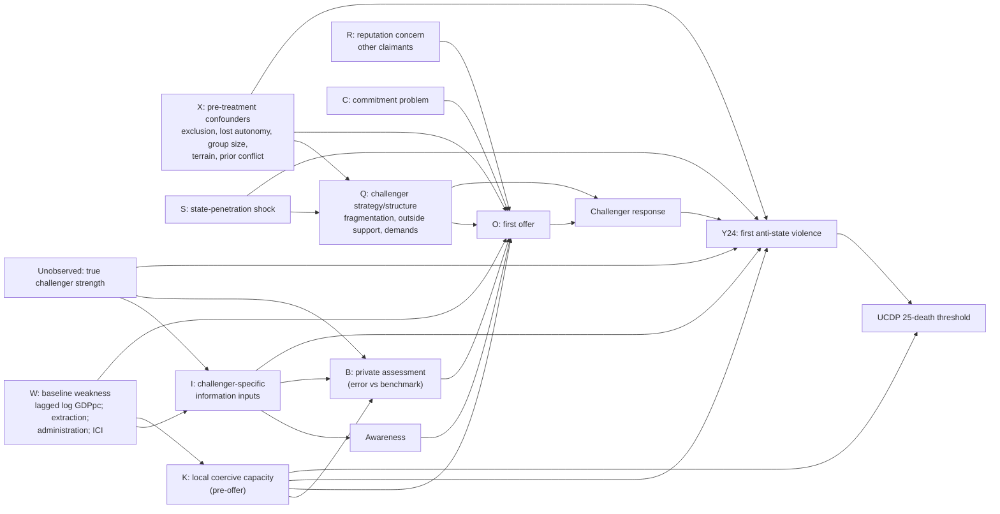

# Dated Causal Graph (drawn before any model is fitted)

*Drawn 2026-10-14, before any data was downloaded or any pilot outcome was inspected. Required by Protocol §Identification and App. A.*

## Reading the graph

| Path | Status | Consequence |
|---|---|---|
| I → B → O → Rsp → Y | **Hypothesized chain** (H1–H3) | Needs every link observed and dated |
| W → I | **Required for the weak-state argument** | If W does not predict I (and optimism), the chain does not explain the classic correlation, even if it exists |
| I → A → O | Information also drives *awareness* | Conditioning on awareness = conditioning on a descendant of treatment → **never select only noticed challengers** |
| I → Y (direct) | Information affects repression and targeting, not just offers | The offer-mediated share is **not identified** by adding O to a regression |
| T → I, T → B, T → Y | True strength confounds everything | The benchmark interval proxies T. Compare at *comparable benchmarked threat*. |
| K → B, K → O, K → Y | Coercive capacity confounds | Condition on **pre-offer** K only. Post-threat deployments are mediators or colliders. |
| R, C, Q → O | Rival causes of a low offer | Must be coded explicitly in each trace |
| Y → U | The UCDP threshold is downstream | Never use UCDP onset as the escalation outcome or as the clock start |

## Assumptions required for a causal (not just associational) claim

1. **Conditional exchangeability:** I ⫫ Y(i) | W, X, K_pre, benchmarked T, period. This is *not* currently defended.
2. **Positivity:** both low-I/high-K and high-I/low-K episodes exist at similar benchmarked threat (gate iii).
3. **No unmeasured preference confounding of O → Y.** Needed for any mediated estimate. Strong; report sensitivity.
4. **Ignorable archive selection, or bounds.** Preservation may depend on W and Y. Gate iv requires bounds.
5. **For within-episode revelation tests:** no change in K, R, C, Q, S between the information shock and the belief/offer revision.

No instrument is currently claimed.
